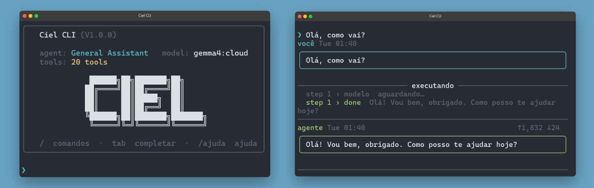
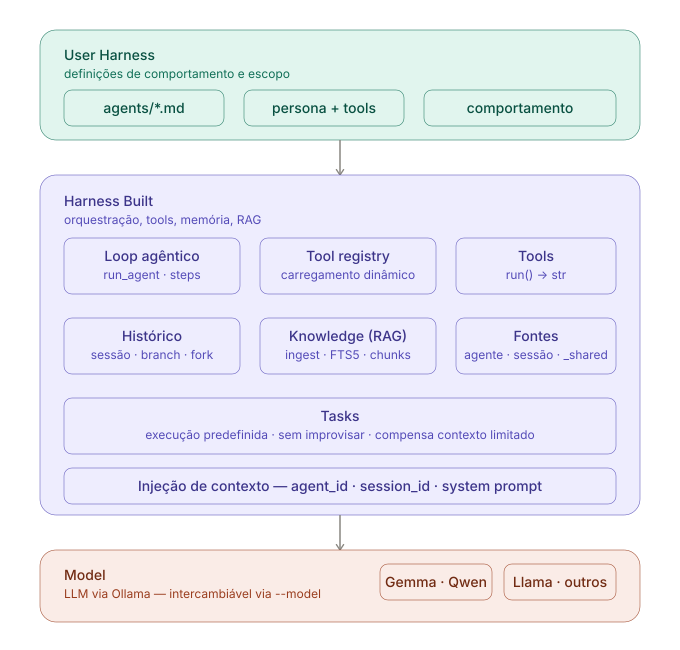

# Ciel CLI

CLI agêntica para automação de tarefas via linguagem natural. Roda com modelos
locais (Ollama) ou com qualquer API OpenAI-compatible, com janela de contexto
otimizada, base de conhecimento por sessão e tools extensíveis.

Cada **persona** é um arquivo `.md` em `/agents/` — troque o comportamento do
agente sem mudar código. O mesmo harness atende CLI, TUI, server web e bot de
WhatsApp.

> **Aviso de segurança:** o agente pode executar scripts Python e instalar
> pacotes via pip. Use um `venv` e considere `--safe` se não confiar no modelo
> ou no input. Leia [Segurança](#segurança) antes de começar.

## Índice

- [Instalação](#instalação)
- [Uso rápido](#uso-rápido)
- [Interfaces](#interfaces)
- [Comandos essenciais](#comandos-essenciais)
- [Agentes e skills](#agentes-e-skills)
- [Tasks](#tasks)
- [Modo build (processos)](#modo-build-processos)
- [Base de conhecimento](#base-de-conhecimento)
- [Modelos e perfis](#modelos-e-perfis)
- [Integrações](#integrações)
- [Segurança](#segurança)
- [Arquitetura](#arquitetura)
- [Documentação](#documentação)

---

## Instalação

**Requisitos:** Python 3.10+, [Ollama](https://ollama.com) rodando (perfil
local) ou um provider configurado, e Git (opcional).

```bash
# 1. Ambiente virtual (recomendado — o agente pode instalar pacotes)
python -m venv venv

# Windows
venv\Scripts\activate.bat        # Prompt de Comando
venv\Scripts\Activate.ps1        # PowerShell

# Linux/macOS
source venv/bin/activate

# 2. Dependências
pip install -r requirements.txt

# 3. Confirme que o Ollama está rodando e baixe um modelo
ollama list
ollama pull gemma4:e2b-it-qat
```

O modelo padrão é o `gemma4:cloud` (via Ollama, exige login uma vez no site do
Ollama). Qualquer modelo local do `ollama list` serve com `--model`.

A TUI é opcional e tem uma dependência extra:

```bash
pip install textual
```

Para ler/escrever `.docx`, PDFs e monitorar hardware, instale também as
dependências de `requirements-extras.txt`.

> Primeira vez? Siga o **[tutorial passo a passo](docs/tutorial.md)** — do zero
> ao primeiro chat, com resolução de problemas.

Ao iniciar, o Ciel valida o Ollama e o modelo (erro bloqueante) e avisa sobre
modelo secundário e tools opcionais sem dependência. Os detalhes estão no
[tutorial](docs/tutorial.md#o-que-o-ciel-verifica-ao-iniciar).

---

## Uso rápido

O ponto de entrada é `ciel.py`. Sem flags ele abre a TUI se o Textual estiver
instalado; senão, a CLI.

```bash
python ciel.py                             # TUI (se instalada) ou CLI
python ciel.py --cli                       # força CLI
python ciel.py --tui                       # força TUI
python ciel.py --agent dev_helper          # persona específica
python ciel.py --model gemma4:e2b-it-qat   # modelo local
python ciel.py --perfil nuvem              # orquestrador no provider de API
python ciel.py --modo build                # construção com processos nativos
python ciel.py --safe                      # sem tools de execução arbitrária
python ciel.py --cli --task tasks/minha_task.md   # task headless
```

| Flag | Ação |
|---|---|
| `--cli` / `--tui` | força a interface (mutuamente exclusivas) |
| `--agent <nome>` | persona inicial |
| `--model <nome>` | modelo local do Ollama |
| `--perfil <local\|nuvem>` | orquestrador da sessão |
| `--modo <chat\|build>` | modo da sessão (`build` exige `nuvem`) |
| `--safe` | remove `run_script`, `create_tool` e `create_temp_tool` |
| `--auto` | não pede confirmação para criação de tools (só CLI) |
| `--task <arquivo.md>` | executa a task e sai (só CLI) |
| `--list-agents` | lista personas e sai (só CLI) |
| `--reset-password` | nova senha do server web (`--sim` dispensa confirmação) |

> Com a TUI instalada, flags só-CLI precisam de `--cli` explícito. `--modo
> build` sem `--tui` também cai na CLI; use `--tui --modo build` para o build
> na TUI. A referência completa de flags está em
> [docs/comandos.md](docs/comandos.md#flags-da-linha-de-comando).

Dentro do Ciel, comece por `/ajuda` e `/agente`:

```text
/ajuda
/agente dev_helper
/task noticias
```



---

## Interfaces

| Interface | Como abrir | Documentação |
|---|---|---|
| **CLI** | `python ciel.py --cli` | esta página |
| **TUI** | `python ciel.py --tui` (requer `textual`) | [docs/tui.md](docs/tui.md) |
| **Server web** | `python server.py` → `http://127.0.0.1:5000` | [docs/server.md](docs/server.md) |
| **Bot WhatsApp** | `python ciel.py bot` | [docs/whatsapp_tutorial.md](docs/whatsapp_tutorial.md) |

**CLI** — rich rendering, autocomplete por Tab e spinner de progresso. É a
interface padrão quando o Textual não está instalado.

**TUI** — três painéis em tempo real (sidebar com sessões, chat com Markdown e
painel de modelo/tokens/CPU). Roda os mesmos agentes, tools e histórico da CLI.

**Server web** — o site simples (`/`) tem chat, sessões, tasks e fontes com
login próprio, mais um **visualizador de arquivos** que abre ao lado do chat o
que o agente gerou (html rodando, markdown, imagem, pdf, texto) — divisória
arrastável, sem abrir arquivo na mão; a interface visual (`/ui`) apresenta a
conversa em um núcleo de partículas, com modos Núcleo, Pesquisa e Artigo. Por
padrão escuta só a máquina local:

```bash
python server.py            # http://127.0.0.1:5000
python server.py --lan      # rede local, sem HTTPS — use só em rede confiável
```

**Bot WhatsApp** — pareia um número via QR e responde mensagens em tempo real;
o MCP de WhatsApp permite enviar mensagens pontuais dentro de qualquer task.

---

## Comandos essenciais

| Comando | Ação |
|---|---|
| `/novo` | inicia nova sessão (pergunta se salva) |
| `/history` | lista, retoma, cria branch ou deleta sessões |
| `/agente` / `/agente <nome>` | mostra ou troca a persona |
| `/tools` | lista as tools ativas na sessão |
| `/tokens` | tokens gastos na sessão |
| `/task` / `/task <nome>` | lista ou executa tasks |
| `/modo <chat\|build>` | alterna conversa e construção |
| `/processo` | lista/executa processos nativos (CLI) |
| `/skill` | lista, mostra e executa skills |
| `/source <arquivo ou URL>` | indexa fonte na base de conhecimento |
| `/img <arquivo>` | envia imagem ao modelo (alias `/imagem`) |
| `/model` | modelos local/secundário e providers |
| `/perfil <local\|nuvem>` | troca o orquestrador da sessão |
| `/connect` | conecta ou atualiza um provider de API |
| `/workspace <caminho>` | libera pasta/arquivo fora do workspace |
| `/mcp` | servidores MCP conectados e suas tools |
| `/tools-extras` | tools opcionais e status de instalação |
| `/ajuda` | todos os comandos |

As sessões são salvas automaticamente. `/history` permite retomar, criar um
branch (a sessão filha herda o histórico e as fontes da pai) ou deletar.

→ **[Referência completa de comandos](docs/comandos.md)** — inclui `/history`,
`/processo --analisar`, `/subagente`, `/lab`, `/preview` e as flags da CLI.

---

## Agentes e skills

Uma persona é um `.md` em `agents/` com título, persona e, opcionalmente,
tools, MCP, skills e regras de comportamento:

```markdown
# Meu Agente

## Persona
Você é um agente especializado em X...

## Tools permitidas
calculator
read_file

## Comportamento
- Regra 1
```

```bash
python ciel.py --agent meu_agente
python ciel.py --cli --list-agents
```

`/criar agente` cria uma persona por entrevista guiada. As seções e os defaults
do arquivo estão em [docs/agents.md](docs/agents.md) · template em
[docs/template_agente.md](docs/template_agente.md).

**Skills** são arquivos `.md` em `skills/` com instruções detalhadas injetadas
no system prompt do modelo secundário — úteis para domínios que um modelo local
pequeno não carrega no contexto. Podem ser executadas sob demanda ou vinculadas
a uma persona com nível `obrigatoria`, `sugerida` ou `opcional`.

```text
/skill                          # lista
/skill frontend-visual          # mostra
/skill frontend-visual crie um portfólio animado
```

Incluídas: `frontend-visual`, `code-review`, `refactor`, `docs-generator` e
`data-analysis`. → [docs/skills.md](docs/skills.md)

---

## Tasks

Tasks são fluxos de execução definidos em `.md`. O agente executa as ações em
ordem, como um inspetor — sem planejar nem improvisar.

```text
/task                        # lista todas
/task noticias               # executa pelo nome (parcial ou exato)
/task tasks/minha_task.md    # executa pelo caminho
/criar task                  # cria por entrevista guiada
```

Para automação sem terminal interativo:

```bash
python ciel.py --cli --task tasks/noticias_do_dia.md
```

Formato, `grupo`, `max_steps` e cron: [docs/tasks.md](docs/tasks.md) ·
template: [docs/template_task.md](docs/template_task.md).

---

## Modo build (processos)

O modo `build` executa **processos nativos** — receitas com spec, fases e
critérios de aceite — em vez de conversa livre. Exige o perfil `nuvem`.

```text
/perfil nuvem
/modo build
quero um app de notas em markdown com preview e salvamento local
```

Se você já inicia com `python ciel.py --modo build`, o perfil `nuvem` é
selecionado automaticamente.

O Ciel detecta o processo (`app_web`, no exemplo), mostra a spec/plano e
executa. Para ser explícito:

```text
/processo                                   # lista os processos (CLI)
/processo app_web "app de notas"
/processo corrigir_bug                      # demo de verificação
```

Cada task pode ter uma **checagem por código** — `arquivo`, `diretorio`,
`comando`, `http` ou `json`. Se falhar, o runner tenta uma correção com o erro
e os arquivos envolvidos. O detalhe fica em `data/runs/<id>/`; a resposta final
é curta: arquivos, como testar e verificação.

Processos disponíveis incluem `app_web`, `web_projeto` (com entrevista),
`landing_page`, `jogo_web`, `analise_dados`, `auditar_repo`, `gerar_testes`,
`corrigir_bug`, `artigo_matematica`, `notebook_matematica` e
`laboratorio_notebook`.

→ [Perfis, modos e processos](docs/processos.md) · [Formato do fluxo e
checks](docs/multitask.md) · [Subagentes](docs/subagentes.md) ·
[Kernels](docs/kernels.md)

---

## Base de conhecimento

Indexa arquivos e páginas web para o agente consultar por relevância, sem
carregar tudo no contexto. Suporta `.pdf`, `.txt`, `.md` e URLs.

```text
/source relatorio.pdf              # só nesta sessão
/source https://exemplo.com/doc    # página web como fonte
/source --global manual.txt        # todas as sessões do agente
/source --listar                   # IDs e resumos
/source --remover 3                # remove a fonte de id=3
```

O agente consulta via `search_knowledge`, `list_sources` e `read_source`.
Fontes de sessão somem com a sessão; `--global` persiste até remoção. Cada
agente tem sua própria base. → [docs/sources.md](docs/sources.md)

---

## Modelos e perfis

| Perfil | Orquestrador | Quando usar |
|---|---|---|
| `local` (padrão) | Ollama (`--model`) | offline, hardware próprio |
| `nuvem` | provider configurado com `/connect` | contexto maior, build, sem GPU |

- `--perfil` / `/perfil` trocam o orquestrador da sessão; o padrão vem de
  `"perfil"` em `ciel_config.json`.
- No perfil `nuvem`, o modelo da API é o principal: a tool `secondary_model`
  não é usada.
- O **modelo secundário** é opcional no perfil local: o orquestrador delega
  tarefas complexas via tool `secondary_model`. Configure de dentro do Ciel:

```text
/connect        # provider, URL, modelo e chave (a chave nunca é exibida)
/model          # ativa o provider conectado
```

A chave fica em `~/.ciel/secrets.json`, fora do repositório; `ciel_config.json`
guarda só o provider ativo. Funciona com NVIDIA Build, OpenRouter, OpenAI e
qualquer endpoint OpenAI-compatible.

Perfil não é modo: `nuvem` é *quem executa*; `build` é *como executa*. →
[docs/processos.md](docs/processos.md) ·
[docs/secondary-model.md](docs/secondary-model.md)

---

## Integrações

**MCP** — conecte servidores externos e use as tools deles sem alterar código:

```text
mcp_add_server(name="telegram", type="stdio",
               command="python", args="mcp/telegram/server.py",
               env="TELEGRAM_BOT_TOKEN=seu_token")
```

```text
/mcp -v       # servidores conectados e tools
```

As tools entram no registry como `mcp_{servidor}__{tool}`; a configuração
persiste em `mcp_servers.json`. O projeto inclui servidores MCP para Telegram,
WhatsApp e Google. → [docs/mcp.md](docs/mcp.md) · tutoriais:
[Telegram](docs/mcp_telegram_tutorial.md) ·
[Notion](docs/mcp_notion_tutorial.md) ·
[Google Sheets/Docs](docs/google_mcp_tutorial.md)

**WhatsApp** — modo bot (responde mensagens) e modo MCP (envio pontual).
Requer Node.js para o bridge local:

```bash
cd mcp/whatsapp && npm install   # uma vez
python ciel.py bot               # sobe o bot e o bridge; escaneie o QR
```

→ [docs/whatsapp_tutorial.md](docs/whatsapp_tutorial.md)

---

## Segurança

- Use **`venv`**: o agente pode instalar pacotes e criar tools dinamicamente.
- **`--safe`** remove `run_script`, `create_tool` e `create_temp_tool` do
  schema — o modelo nunca vê essas tools.
- Toda criação de tool mostra o código e pede confirmação
  (`[s] sim [n] não [a] auto`). `--auto` dispensa as confirmações da sessão;
  em `--task` headless a criação é recusada, a menos que `--auto` seja passado.
- **Workspace guard**: paths fora da pasta onde o Ciel foi iniciado pedem
  permissão explícita. `[a]` persiste o grant em `.ciel_workspace.json`;
  `/workspace <caminho>` libera um caminho manualmente. Em headless, acesso
  externo é recusado sem prompt.
- **Server web**: senha própria, cookie assinado e modo seguro para visitantes.
  Esqueceu a senha? `python ciel.py --reset-password` (preserva as chaves de
  provider). O `--lan` não tem HTTPS: use só em rede confiável.

→ **[Detalhes, limitações e o que cada proteção cobre](docs/seguranca.md)**

---

## Arquitetura

<p align="center">
  
</p>

O modelo é intercambiável — o valor está no harness: tool registry dinâmico,
sessões com branch/fork, base de conhecimento por sessão e injeção de contexto
otimizada para janelas pequenas.

Tasks e processos existem para compensar a janela curta de modelos locais: em
vez de pedir um plano grande ao modelo pequeno, o fluxo já define as etapas e o
harness verifica cada uma por código.

→ [Decisões de arquitetura](docs/decisoes.md) ·
[Estrutura do projeto](docs/estrutura.md)

---

## Documentação

| Assunto | Documento |
|---|---|
| Do zero ao primeiro chat | [tutorial.md](docs/tutorial.md) |
| Referência de comandos e flags | [comandos.md](docs/comandos.md) |
| TUI e atalhos | [tui.md](docs/tui.md) |
| Server web, login e `/ui` | [server.md](docs/server.md) |
| Agentes (personas) | [agents.md](docs/agents.md) · [template](docs/template_agente.md) |
| Skills | [skills.md](docs/skills.md) |
| Tasks | [tasks.md](docs/tasks.md) · [template](docs/template_task.md) |
| Perfis, modos e processos | [processos.md](docs/processos.md) |
| Motor de quadro, fluxos e checks | [multitask.md](docs/multitask.md) |
| Subagentes e paralelismo | [subagentes.md](docs/subagentes.md) |
| Kernels e scaffolds | [kernels.md](docs/kernels.md) |
| Base de conhecimento | [sources.md](docs/sources.md) |
| Modelo secundário e providers | [secondary-model.md](docs/secondary-model.md) |
| MCP | [mcp.md](docs/mcp.md) |
| Integrações | [Telegram](docs/mcp_telegram_tutorial.md) · [Notion](docs/mcp_notion_tutorial.md) · [Google](docs/google_mcp_tutorial.md) · [WhatsApp](docs/whatsapp_tutorial.md) |
| Segurança | [seguranca.md](docs/seguranca.md) |
| Estrutura e arquivos | [estrutura.md](docs/estrutura.md) |
| Decisões de arquitetura | [decisoes.md](docs/decisoes.md) |
| Testes e cobertura | [TESTING.md](docs/TESTING.md) · [ROADMAP_TESTES.md](docs/ROADMAP_TESTES.md) |
| Benchmark de casos de uso | [BENCHMARK.md](docs/BENCHMARK.md) |

---

## Licença

MIT — veja [LICENSE](LICENSE).
