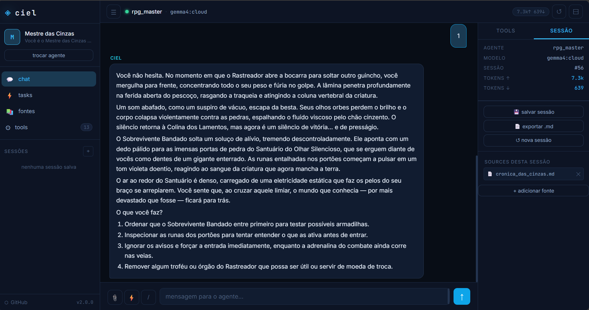

# Server web

O `server.py` expõe o Ciel no navegador usando os **mesmos** agentes, tools,
sessões e base de conhecimento da CLI. Ele serve duas superfícies:

| Superfície | Endereço | Papel |
|---|---|---|
| **Site simples** | `/` | chat, sessões, tasks, fontes e ajustes — o "CLI no navegador" |
| **Interface visual** | `/ui` | apresentação de partículas: núcleo, pesquisa, artigos, painéis e voz |



## Iniciar

```bash
python server.py
```

Por padrão escuta **só nesta máquina**:

```text
http://127.0.0.1:5000
```

Para abrir na rede local (celular, outro PC), use `--lan`. Não há HTTPS: use
apenas em rede confiável.

```bash
python server.py --lan
```

```text
http://192.168.x.x:5000
```

### Flags

| Flag | Ação |
|---|---|
| `--agent <nome>` | persona inicial |
| `--model <nome>` | modelo do Ollama (padrão: o salvo pela interface) |
| `--port <porta>` | porta (padrão `5000`) |
| `--host <endereço>` | endereço de escuta (padrão `127.0.0.1`) |
| `--lan` | equivale a `--host 0.0.0.0` |
| `--safe` | modo seguro permanente, ignora autenticação |
| `--debug` | modo debug do Flask |
| `--reset-password [--sim]` | gera nova senha e sai |

## Login e senha

Na primeira execução o server gera uma **senha padrão** e a mostra no terminal.
Ela fica ativa até você trocá-la em **cadeado → trocar senha**, no topo da
página. O hash fica em `~/.ciel/secrets.json`, o mesmo arquivo das chaves de
provider (fora do repositório).

O login define o que a sessão pode fazer:

| Estado | Tools disponíveis |
|---|---|
| deslogado | modo seguro: `run_script`, `create_tool` e `create_temp_tool` ficam fora |
| logado | todas as tools do agente |
| `--safe` | modo seguro permanente, mesmo logado |

Downloads (`/download`), visualização (`/preview`) e listagem de arquivos
(`/api/files`) exigem login, e servem apenas arquivos de `data/`. Indexar fonte
local (`/api/source`) também exige login.

### Esqueci a senha

Gere outra sem perder as chaves de provider:

```bash
python ciel.py --reset-password         # pede confirmação ("resetar")
python ciel.py --reset-password --sim   # sem confirmação (automação)
```

Também funciona como `python server.py --reset-password`. Sem terminal
interativo o comando recusa, a menos que você passe `--sim` de propósito. A
senha nova aparece uma vez no terminal e **todas as sessões abertas no
navegador caem** (o token é assinado a partir do hash da senha).

O reset é operação de **nível de sistema**: roda no terminal, sem token e sem
passar pelo workspace guard — é o usuário do SO, dono do arquivo, quem executa.
Não apague `~/.ciel/secrets.json` para recuperar a senha: leva as chaves de
provider no mesmo arquivo. Para guardar os segredos em outro lugar, defina
`CIEL_SECRETS_PATH`.

## Comportamento

- **Um turno por vez.** O estado é de uma sessão por processo: um segundo envio
  simultâneo recebe `409` em vez de intercalar o histórico. O front avisa
  "turno em andamento" e você reenvia depois.
- **Tools interativas.** No site simples, tools como `entrevista_interativa`
  funcionam no navegador: a pergunta aparece no chat com botões (ou campo
  livre) e o turno fica pausado esperando a resposta. Depois de responder, o
  card mostra "o agente está pensando…" até a próxima pergunta ou a resposta
  final. O botão **parar** cancela o turno mesmo com uma pergunta pendente.
- **Anexos do chat.** Arquivo de texto entra como texto; **PDF** sobe para
  `/api/file/extrair` e entra como o texto extraído (nada é salvo em disco).
  PDF digitalizado, sem texto, é recusado com mensagem — aí o caminho é
  **Fontes** + `read_pdf`. Anexo binário vindo de cliente antigo é barrado com
  `400`, para não gravar bytes no histórico. Ao reabrir a sessão, a bolha do
  usuário mostra só a mensagem e `📎 nome`, não o conteúdo do arquivo.
- **Consumo.** **Ajustes → consumo** mostra o teto de contexto do modelo ativo
  (perfil + override), o uso da sessão em tokens, a cota do modelo secundário
  (com barra de uso) e o **último limite** que barrou uma chamada — deixando
  claro se foi a cota que você definiu ou o provedor (rate limit/contexto/crédito).
  O painel da sessão (à direita) traz as mesmas cotas em três barras: **sessão**
  (entrada acumulada), **envio** (último envio contra a janela, com link de
  "nova sessão com resumo" a partir de 85% do envio) e **secundário** (só no
  perfil local). Avisos em 80%/95%; o bloqueio só acontece no teto da sessão —
  o turno que cruza termina e o seguinte é que não começa.
  Perto do teto aparece o bloco de limite com duas saídas: **continuar nesta
  sessão** (comprime: resume o que já foi discutido, tira os turnos antigos do
  contexto e zera o contador) ou **começar uma nova** (branch com o resumo).
- **Interface visual.** O `/ui` ainda não renderiza essas perguntas: nele a
  tool segue o comportamento antigo.

## Visualizador de arquivos

A tela de chat divide o espaço com um painel de visualização (como os
artefatos do Claude). Ele abre sozinho quando o agente gera um arquivo, ou
por um destes caminhos:

- **chips "arquivo gerado"** embaixo da resposta do turno — um por arquivo
  (nome abre a prévia, `↓` baixa) e um por projeto, marcado como `site`;
- botão **ver** ao lado de cada link de download no chat;
- nome da fonte no painel de fontes (uploads caem em `data/user/sources/`);
- botão do olho na topbar → navegador de arquivos de `data/user/`, com
  `▶` nas pastas que têm `index.html` e "abrir esta pasta como site".

A divisória entre chat e painel é arrastável (duplo clique volta ao padrão; a
largura fica salva no navegador). Em tela estreita o painel cobre a tela em
vez de dividir.

Abrir o visualizador **recolhe o painel direito** quando a prévia deixaria o
chat com menos de ~440px (notebook, janela pequena); em tela larga ele fica.
Se você reabrir o painel na mão com a prévia aberta, a interface respeita e não
recolhe mais sozinha até recarregar a página — e, ao fechar a prévia, o painel
só volta se foi o visualizador quem o recolheu.

### Como a detecção funciona

Antes e depois de cada turno o server tira um retrato (`caminho → mtime`) de
`data/user`. O que apareceu ou mudou é o que o agente gerou — venha de
`write_file`, `write_files`, `secondary_model`, `run_script` ou tool de MCP.
Não depende de adivinhar nomes pelo texto da resposta (era o que falhava no
`secondary_model`, que salva uma pasta e responde só "arquivos salvos em
data/user/foo") nem do metadata da tool.

Pasta que contém `index.html` vira **uma** entrada de projeto, e o painel abre
a pasta inteira como site — não o `index.html` solto.

A lista vai junto com o trace da sessão, então **reabrir uma conversa antiga
mostra os mesmos chips**. Sessão gravada antes disso existir é reconstruída
pelos caminhos de `data/` citados na resposta — só os que ainda existem viram
chip; menção solta a nome inexistente é ignorada.

### Página gerada roda em origem própria

Projeto ou `html` avulso é servido por um **servidor estático efêmero**, um por
pasta, em porta própria e com token no caminho (`/p/<token>/...`). Foi a forma
de ter as três coisas que o iframe do Flask não dava ao mesmo tempo:

1. `style.css` e `script.js` irmãos carregam (no iframe `sandbox` os
   subrecursos saíam sem cookie e voltavam 401 — a página abria "crua");
2. `<script type="module">`, `fetch()` de arquivo vizinho e `localStorage`
   funcionam, porque a página tem origem de verdade;
3. a página **não** alcança a API nem o cookie do Ciel: é outra origem.

O servidor escuta só em loopback (ou em `0.0.0.0` com `--lan`), serve apenas a
pasta de um projeto dentro de `data/`, exige o token e não lista diretório.
O rodapé do painel mostra a porta em uso (`site :5123`).

| Tipo | Como abre |
|---|---|
| `html` / `htm`, pasta com `index.html` | servidor estático próprio (página rodando) |
| `md` | renderizado com Markdown |
| `txt`, código, `json`, `csv`, `log`… | `<pre>` com destaque de sintaxe |
| imagem (`png`, `jpg`, `svg`…) | `` |
| `pdf` | visualizador nativo do navegador |

`docx`, `xlsx`, `pptx`, zip e binários **não têm visualização**: o painel mostra
um cartão com o botão de download. O mesmo vale para aplicação com backend —
Flask/Django/Java/C++ precisam de processo próprio; aí o download continua
sendo o caminho.

No markdown, `` e `[link](outro.md)` são resolvidos
contra a pasta do próprio arquivo (não contra a raiz do Ciel), e link para
outro arquivo de `data/` abre no painel em vez de sair do app.

### Fontes registradas (inclusive fora de `data/`)

Clicar no nome de uma fonte abre o arquivo no painel, venha ele de onde vier.
Fonte é conteúdo que você indexou de propósito, então a permissão é o registro
na tabela de fontes — não o caminho. Arquivo em `data/` usa a rota normal;
arquivo fora de `data/` (Downloads, outra pasta do workspace) usa
`/api/source/<id>/preview`, que não copia nada e não exige mover arquivo.

O que não abre continua com motivo à vista: arquivo que sumiu do disco mostra
“não está mais no disco” (no tooltip e numa mensagem no chat ao clicar),
credenciais e bancos do Ciel são recusados, e html de fonte chega como texto —
não roda página na origem do Ciel.

### Rotas (para quem for mexer)

| Rota | O que faz |
|---|---|
| `GET /preview/<path>` | serve um arquivo **inline** (markdown, imagem, pdf, texto), com MIME, `no-store` e login |
| `GET /api/files?path=` | lista uma pasta de `data/` (padrão `data/user`) e marca `site` |
| `GET /api/preview_site?path=` | sobe/reaproveita o servidor estático da pasta e devolve a URL com token |
| `GET /api/source/<id>/preview` | serve o arquivo de uma **fonte registrada** (mesmo fora de `data/`); `?dl=1` baixa |

O guard do `/preview` e do `/download` é só `data/` (nada de config, banco ou
credencial). A rota de fonte é a exceção deliberada: só aceita `id` que existe
na tabela de fontes, e ainda recusa credenciais, bancos e dotfiles.

## Interface visual (`/ui`)

Abra com o server rodando:

```text
http://127.0.0.1:5000/ui
```

A tela é um canvas de partículas com o chat. Em **Ajustes** ficam os controles
principais:

- **Apresentação** — `Núcleo`, `Pesquisa` e `Artigo`. O modo define o que o
  agente pode desenhar na tela: no `Núcleo` é só conversa; em `Pesquisa` ele
  abre painéis (texto, tarefas, notícias, imagens, vídeo e feed); em `Artigo` a
  resposta vira um artigo no palco.
- **Artigos** — no modo Artigo, os artigos abertos ficam numa barra lateral. Os
  que você **salvar** vão para o SQLite e reabrem entre sessões e reinícios do
  server; os demais vivem só na sessão.
- **Formas de tool / Profundidade** — liga o desenho animado associado a cada
  tool e controla a quantidade de partículas da cena (custo visual).
- **Leitura** — liga a leitura em voz alta pelo próprio navegador.
- **Falar** — grava áudio do microfone e transcreve localmente com
  `faster-whisper` (dependência opcional: `pip install faster-whisper`).

A interface visual **não tem tela de login**: ela abre sem cookie e, por isso,
roda em modo seguro. Se você entrar no site simples (`/`) primeiro, o cookie
vale também para `/ui` e libera as tools de execução.

Configuração em `ciel_config.json`:

```json
{
  "ui_anotar": { "criar_formas": false, "live": true, "live_motor": "heuristica" },
  "ui_voz":    { "modelo": "base", "idioma": "pt", "device": "auto" }
}
```

`live_motor` aceita `heuristica` (rápido, local) ou `secundario` (mais preciso,
gasta cota). `ui_voz` tem os mesmos campos do Whisper local: modelo, idioma,
device, `beam_size`, `preload` e `pasta_modelos`.

## Limitações

- Sem HTTPS e sem controle de acesso por usuário: é um server local.
- `--lan` expõe a interface para a rede; use só em rede confiável.
- O `/ui` é uma camada de apresentação; o harness e as tools são os mesmos da
  CLI e da TUI.
- `--safe` ignora a autenticação de propósito: o server inteiro fica restrito.

→ [Segurança](seguranca.md) · [TUI](tui.md) · [Comandos](comandos.md)
